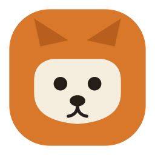

  

  # Sploot Labs — Brand Kit

  **L'IA open source, à hauteur de pattes.** 🐾

Kit de marque complet, prêt à commiter. Direction unique retenue : **Sploot Labs**.

## Contenu

| Fichier | Pour |
|---|---|
| [`DEV-HANDOFF.md`](./DEV-HANDOFF.md) | **👉 Le récap dev** — couleurs, typo, tokens, règles logo |
| [`design-tokens.css`](./design-tokens.css) | Variables CSS, light + dark (auto + toggle) |
| [`design-tokens.json`](./design-tokens.json) | Tokens en JSON (build tools, autres plateformes) |
| [`tailwind.tokens.js`](./tailwind.tokens.js) | Extension de thème Tailwind |
| [`voice-and-tone.md`](./voice-and-tone.md) | Taglines, 4 principes éditoriaux, lexique |
| [`assets/`](./assets/) | Logos, favicon, avatar, mascotte (SVG) |
| [`templates/`](./templates/) | README org, README projet, CONTRIBUTING |

## Assets

| Fichier | Usage |
|---|---|
| `logo-badge.svg` | Avatar GitHub, app icon |
| `logo-badge-mono.svg` | Version N&B (terminal, badges) |
| `favicon.svg` | Favicon 32px |
| `mark-sploot.svg` | Marque signature (sploot vu du ciel) |
| `avatar-round.svg` | Réseaux sociaux |
| `wordmark.svg` | Logotype (à vectoriser pour figer) |
| `mascot-corgi.svg` | Illustration mascotte |

## Identité en 15 secondes

- **Couleurs :** ginger `#D9772B` (pop) + petrol `#1E5F60` (technique), neutres chauds, dark mode natif.
- **Typo :** Bricolage Grotesque (titre) · Hanken Grotesk (texte) · JetBrains Mono (code).
- **Mascotte :** corgi, silhouette basse, **sans queue** (Pembroke), joyeux mais posé.
- **Ton :** doux dessus, crédible dessous, fun en easter egg.

## À faire avant l'annonce

- [ ] Réserver l'org GitHub `github.com/splootlabs`
- [ ] Valider `splootlabs.dev` au registrar (WHOIS non fait — raisonnement seulement)
- [ ] Générer `favicon.ico` / PNG 512 depuis les SVG
- [ ] Créer le repo `splootlabs/.github` et y déposer `profile/README.md` + `assets/`

---

Brand book interactif : voir l'artifact publié. · À hauteur de pattes 🐾
